# Manual de usuario (versión inicial) · LobbyMaster

**Autor:** Yair Anibal Mamani Ticona · **Versión del sistema:** 0.3.0 (Beta 3) · **Proyecto de Sistemas I, gestión 2-2026**

Este manual explica cómo usar LobbyMaster paso a paso. Es la versión **inicial**: cubre lo que ya está disponible en la beta y crecerá con cada sprint.

---

## 1. Qué es LobbyMaster

LobbyMaster es una página web para **organizar torneos de eSports** (videojuegos competitivos) en La Paz y El Alto. Con ella se puede:

- Crear torneos y recibir inscripciones de equipos.
- Aprobar o rechazar inscripciones.
- Generar automáticamente el **bracket** (el cuadro de partidas de eliminación directa).
- Registrar resultados, ver el avance del ganador y coronar al **campeón**.
- Consultar estadísticas, ranking y las sedes en un mapa.

## 2. Cómo abrirla

1. Descomprime la carpeta del proyecto (o clónala desde GitHub).
2. Abre el archivo `frontend/index.html` con doble clic. Funciona en Chrome, Edge o Firefox.
3. No necesita instalar nada ni conexión a internet (con internet carga mejor las tipografías).

> En esta beta los datos se guardan en tu navegador. Cada persona ve sus propios datos.

## 3. Tipos de usuario (roles)

| Rol | Qué puede hacer |
|---|---|
| **Jugador** | Crear su equipo y su plantilla de jugadores, inscribir el equipo en torneos abiertos, ver brackets, ranking y estadísticas. |
| **Organizador** | Crear y administrar **sus** torneos: aprobar inscripciones, generar el bracket y registrar resultados. |
| **Administrador** | Todo lo anterior, más la gestión de usuarios y roles, juegos, sedes, datos y modelo de datos. |

### Cuentas de demostración

| Rol | Usuario | Contraseña |
|---|---|---|
| Administrador | `admin` | `Admin2026` |
| Organizador | `organizador` | `Organiza2026` |
| Jugador | `jugador` | `Jugador2026` |

En la pantalla de ingreso también hay botones de acceso rápido para estas cuentas.

## 4. Ingresar o crear una cuenta

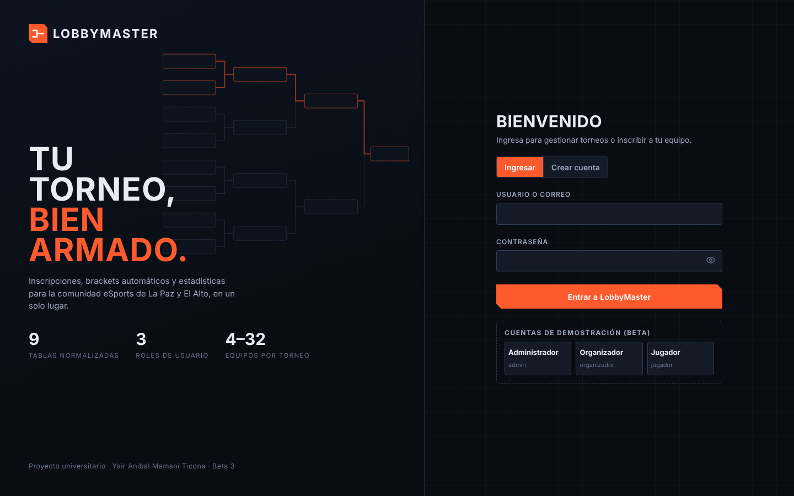

**Para ingresar:** escribe tu usuario (o correo) y tu contraseña y pulsa **Entrar a LobbyMaster**.

**Para crear una cuenta:** pulsa la pestaña **Crear cuenta** y completa:

- **Usuario:** de 3 a 20 caracteres (letras, números o guion bajo).
- **Correo electrónico:** debe ser válido y no estar usado.
- **Contraseña:** mínimo 8 caracteres, con letras y números. Una barra te muestra qué tan fuerte es.
- **Repetir contraseña.**

Las cuentas nuevas son de **jugador**. Solo un administrador puede cambiar el rol.

**Si te equivocas varias veces:** tras 5 intentos fallidos la cuenta se bloquea 30 segundos por seguridad.

## 5. Conocer la pantalla

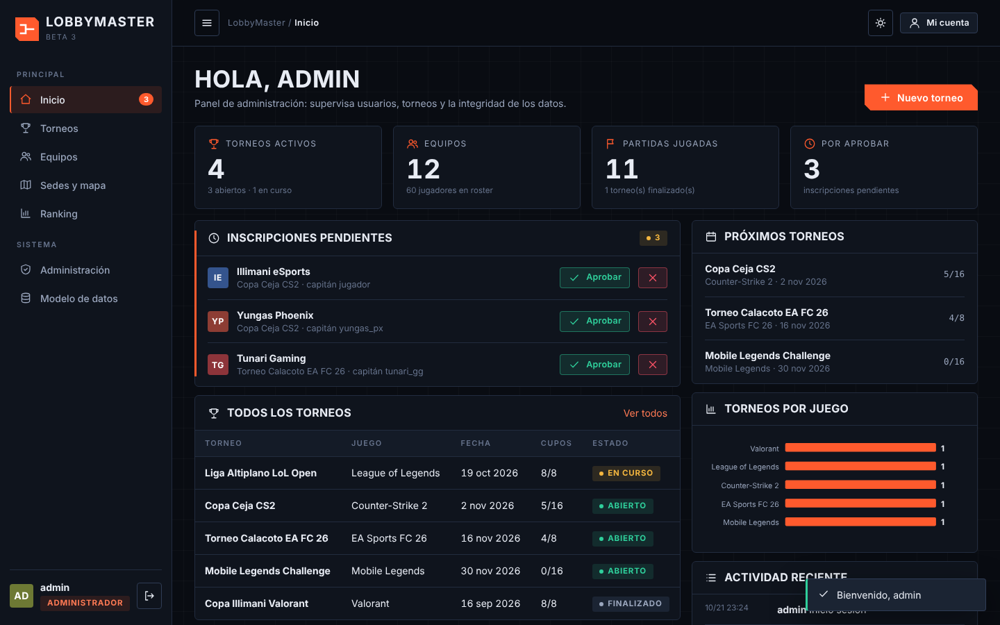

- **Menú lateral:** Inicio, Torneos, Mis equipos, Sedes y mapa, Ranking y, si eres administrador, Administración y Modelo de datos.
- **Barra superior:** botón de tema claro/oscuro y **Mi cuenta** (aquí puedes cambiar tu contraseña).
- **Inicio:** muestra indicadores y tareas según tu rol (por ejemplo, inscripciones por aprobar).
- Para salir, usa el botón de cerrar sesión junto a tu nombre en el menú.

## 6. Guía para el jugador

### 6.1 Crear tu equipo
1. Entra a **Mis equipos** y pulsa **Crear equipo**.
2. Escribe el nombre (debe ser único) y agrega a tus jugadores (de 2 a 8). Tú quedas como **capitán**.

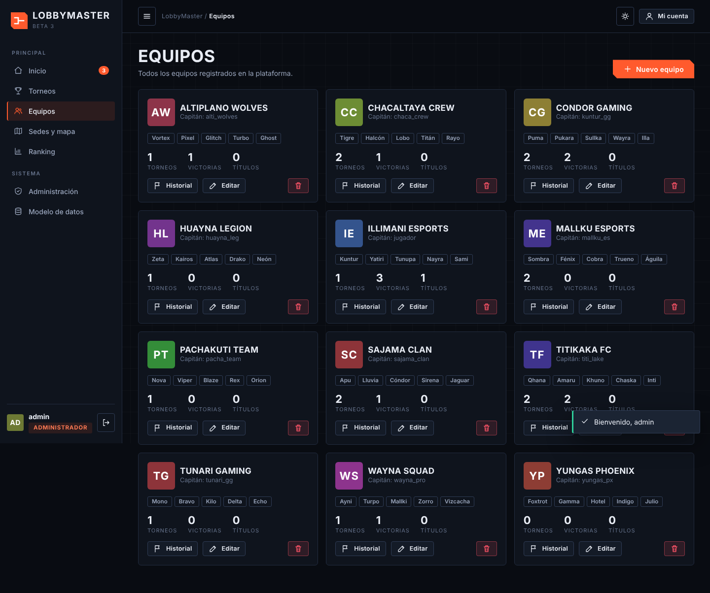

### 6.2 Inscribir tu equipo en un torneo
1. Entra a **Torneos** y busca uno con estado **Abierto**. Puedes filtrar por juego o estado.
2. Abre el torneo y pulsa **Inscribir mi equipo** → **Enviar inscripción**.
3. Tu inscripción queda **Pendiente** hasta que el organizador la apruebe. Puedes verla en **Mis inscripciones** y retirarla si cambias de idea.

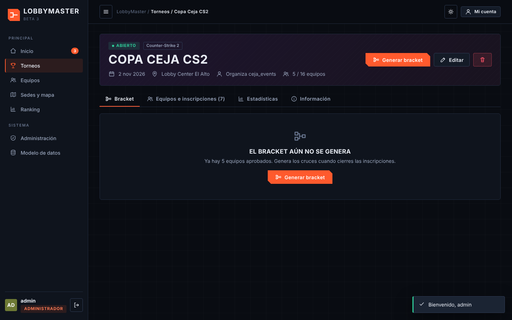

Reglas: solo el capitán inscribe; un equipo no se inscribe dos veces en el mismo torneo ni en dos torneos el mismo día.

### 6.3 Ver el bracket, ranking y estadísticas
- Dentro de cada torneo, la pestaña **Bracket** muestra el cuadro de partidas y la pestaña **Estadísticas** los resultados del torneo.
- **Ranking** muestra los equipos con más títulos, victorias y efectividad.

## 7. Guía para el organizador

### 7.1 Crear un torneo
1. Entra a **Torneos** → **Nuevo torneo**.
2. Completa: nombre (5 a 40 caracteres, único), juego, sede, fecha (no pasada) y cupos (de 4 a 32).
3. Pulsa **Guardar**. El torneo queda **Abierto** para recibir inscripciones.

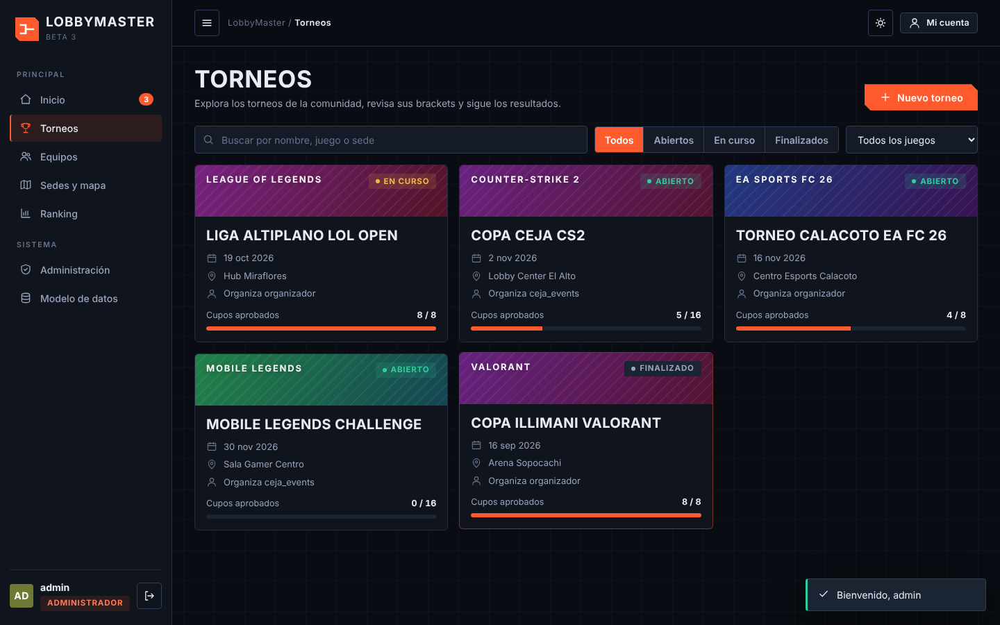

### 7.2 Aprobar inscripciones
1. Abre tu torneo y entra a la pestaña **Equipos e inscripciones**; ahí aparecen las **Inscripciones pendientes**.
2. Pulsa **Aprobar** o rechaza cada equipo. No se pueden aprobar más equipos que los cupos.

### 7.3 Generar el bracket
1. Cuando haya **al menos 4 equipos aprobados**, pulsa **Generar bracket**.
2. El sistema arma los cruces de **eliminación directa**. Si sobran lugares, algunos equipos reciben **BYE**: pasan directo a la siguiente ronda sin jugar.

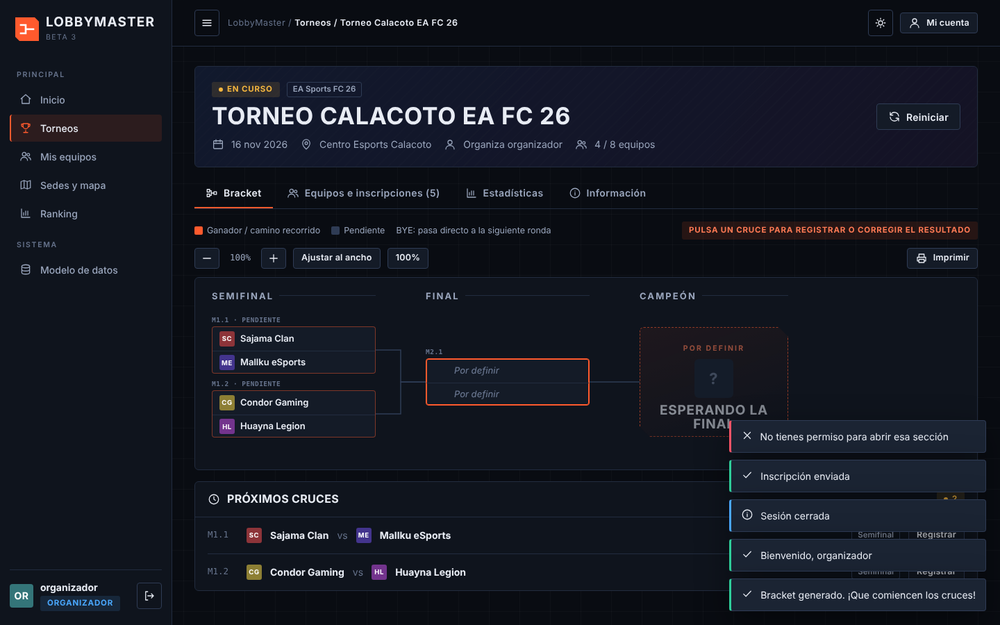

### 7.4 Registrar resultados
1. Haz clic en un cruce del bracket y escribe el puntaje de cada equipo (números de 0 a 99, sin empates).
2. Al guardar, el ganador avanza solo a la siguiente ronda.
3. Si te equivocaste, usa **Corregir resultado**. Si el cambio altera al ganador, el sistema **te avisa cuántas rondas siguientes se borrarán** y pide confirmación.

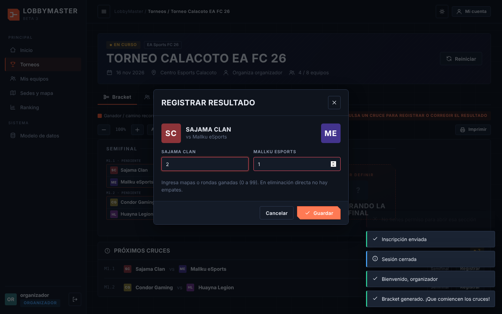

### 7.5 Coronar al campeón
Cuando se juega la final, el torneo pasa a **Finalizado** y el campeón se destaca en el bracket y en las estadísticas.

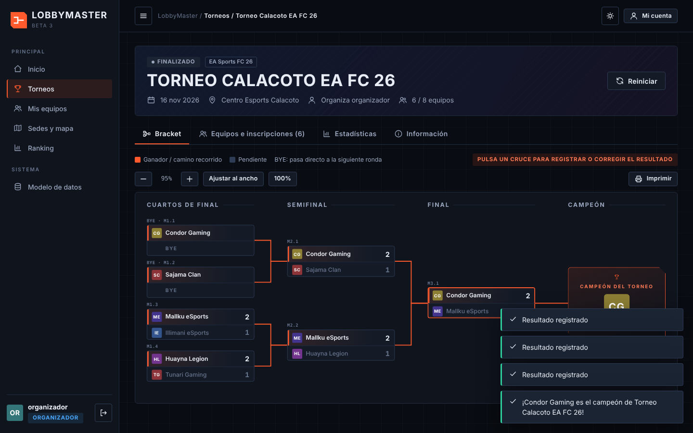

## 8. Guía para el administrador

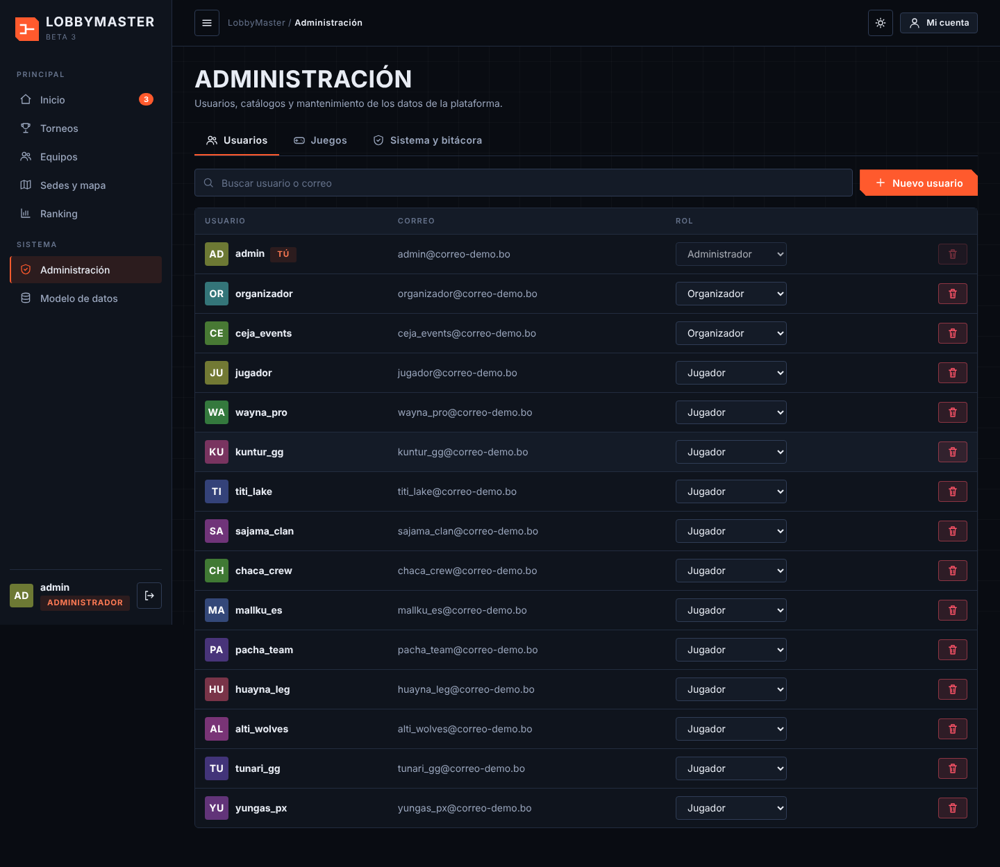

En **Administración** puedes:

- **Usuarios:** cambiar el rol o eliminar cuentas (siempre debe quedar al menos un administrador).
- **Juegos y sedes:** agregar o editar los catálogos (no se elimina uno que esté en uso).
- **Bitácora:** ver las últimas acciones del sistema.
- **Datos:** exportar la información en SQL o JSON y **Restaurar datos de demostración**.

En **Modelo de datos** se muestran el diagrama entidad-relación, la normalización (sin normalizar → 1FN → 2FN → 3FN), el diccionario de datos y un explorador de las 9 tablas.

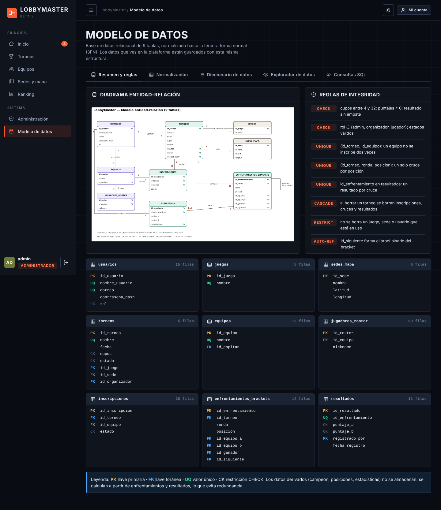

## 9. Sedes y mapa
En **Sedes y mapa** se ven las sedes de torneos con su ubicación y un enlace para abrir **Cómo llegar** en Google Maps.

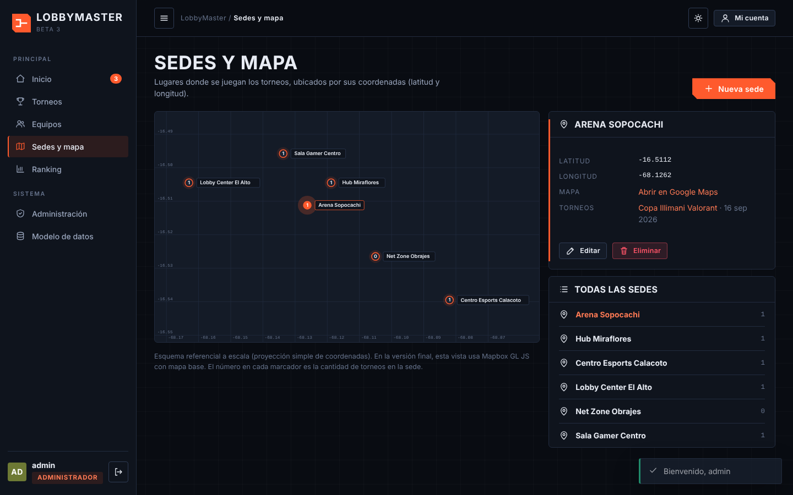

## 10. Problemas frecuentes

| Problema | Qué hacer |
|---|---|
| «Usuario o contraseña incorrectos» | Revisa mayúsculas y minúsculas. Tras 5 fallos, espera 30 segundos. |
| No me deja inscribir mi equipo | Verifica que seas el capitán, que el torneo esté **Abierto**, que haya cupos y que no estés ya inscrito ese día. |
| No puedo generar el bracket | Necesitas al menos 4 equipos **aprobados** y ser el organizador del torneo (o administrador). |
| No veo el menú Administración | Es solo para administradores. |
| La pantalla se ve mal o dio un error | Recarga la página. Si persiste, un administrador puede usar **Restaurar datos de demostración**. |

## 11. Alcance de esta versión inicial

Disponible hoy: registro e ingreso con roles, torneos, inscripciones, bracket automático, resultados, campeón, estadísticas, ranking, sedes y administración.
Pendiente para próximos sprints: historial completo y panel avanzado del organizador, servidor con base de datos compartida y recuperación de contraseña por correo.

---
*Manual elaborado por Yair Anibal Mamani Ticona · LobbyMaster v0.3.0*
